<div align="center">

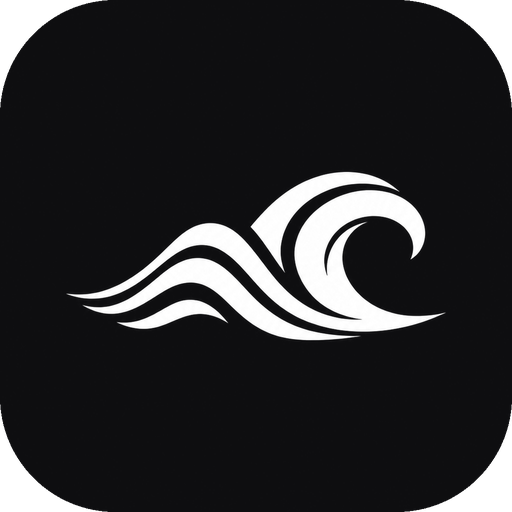

<h1>OpenWave</h1>

<p><strong>A free, ad-free music player for Windows, macOS and Linux.</strong></p>

<p>Stream music, bring your playlists from Spotify and YouTube, and make the sound your own.<br>
No subscription. No account. No telemetry.</p>

<p>
  <a href="#license"></a>
  
</p>

<p>
  <a href="#download"><strong>Download</strong></a> &middot;
  <a href="#features">Features</a> &middot;
  <a href="#import-from-spotify--youtube">Import</a> &middot;
  <a href="#screenshots">Screenshots</a> &middot;
  <a href="#installation">Install</a> &middot;
  <a href="#build-from-source">Build</a> &middot;
  <a href="#faq">FAQ</a>
</p>

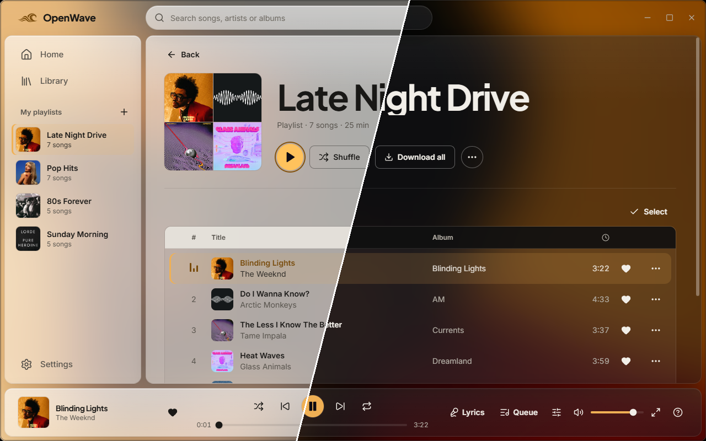

</div>

## Download

| Platform | Download |
|---|---|
| Windows 10 / 11 · x64 | [Installer](https://github.com/bebeyat/openwave/releases/latest/download/OpenWave-windows-x64-setup.exe) · [Portable zip](https://github.com/bebeyat/openwave/releases/latest/download/OpenWave-windows-x64-portable.zip) |
| macOS 11+ · Apple Silicon | [ZIP archive](https://github.com/bebeyat/openwave/releases/latest/download/OpenWave-macos-arm64.zip) |
| Linux · x86_64 | [tar.gz archive](https://github.com/bebeyat/openwave/releases/latest/download/OpenWave-linux-x86_64.tar.gz) |

[All releases](https://github.com/bebeyat/openwave/releases) · [SHA-256 checksums](https://github.com/bebeyat/openwave/releases/latest/download/SHA256SUMS) · [Installation guide](#installation)

> [!NOTE]
> OpenWave is free on every platform. Windows is the most tested; the macOS and Linux builds are newer and
> still marked **experimental**, and media keys / the system media overlay are Windows-only for now.

## Features

- **Stream & discover.** Search songs, albums, artists and playlists from YouTube Music. Find recommendations, genre rows and personal mixes on Home.
- **Bring your music.** Import public Spotify, YouTube and YouTube Music playlists, or add local files with tags and embedded covers.
- **Listen offline.** Download songs, playlists or your likes, with progress and cancellation controls.
- **Shape the sound.** Adjust speed, pitch, reverb and bass, or choose a preset such as *Slowed + reverb* or *Nightcore*.
- **Make it yours.** Light and dark themes, accent colours from album covers, custom playlist covers and layout options.
- **Manage your library.** Select multiple songs to queue, save, download or remove them.
- **Lyrics & Discord.** Turn on synced lyrics from LRCLIB in the fullscreen player or share your listening status on Discord. Both are optional.
- **Keep control.** No sign-in, ads or analytics. Your library and settings stay on your disk. See [Privacy](docs/PRIVACY.md) for network requests.

<details>
<summary>Available in 15 languages</summary>

English, Türkçe, Deutsch, Español, Français, Português, Italiano, Русский, Українська, Polski,
Nederlands, 日本語, 한국어, 中文 and Bahasa Indonesia.

</details>

## Import from Spotify & YouTube

Open **Library → + Add → Bring from elsewhere**, choose a source and paste a public playlist link.
OpenWave matches the songs against the YouTube Music catalog and shows a preview. Press **Add to my library**
to save the playlist; nothing is saved before you confirm.

| Source | What to use |
|---|---|
| Spotify | A public or shared playlist link from `open.spotify.com` — no Spotify account or API key needed. |
| YouTube / YouTube Music | A public playlist link from `youtube.com` or `music.youtube.com`. |
| Local files | Files or a folder on your computer, including MP3, M4A and FLAC with tags and embedded covers. |

The result lists any songs that could not be matched. Spotify's embed page can limit very long playlists;
the import dialog tells you when that happens.

<details>
<summary>Watch a playlist import</summary>

<p align="center">
  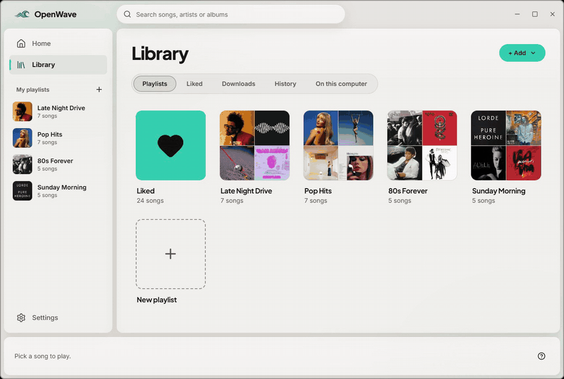
</p>

</details>

## Sound effects

Open **Sound effects** from the player bar. Changes apply while streamed, downloaded or local music plays.

- **Speed** — slow down or speed up, with or without changing the key.
- **Pitch** — adjust in semitones, linked to speed or independently.
- **Reverb** — choose *Room, Lounge, Plate, Hall* or *Cathedral*.
- **Bass boost** — add extra low end.
- **Presets** — *Slowed + reverb*, *Nightcore*, *Concert hall*, or *Normal* to reset.

<details>
<summary>View the sound effects panel</summary>

<p align="center">
  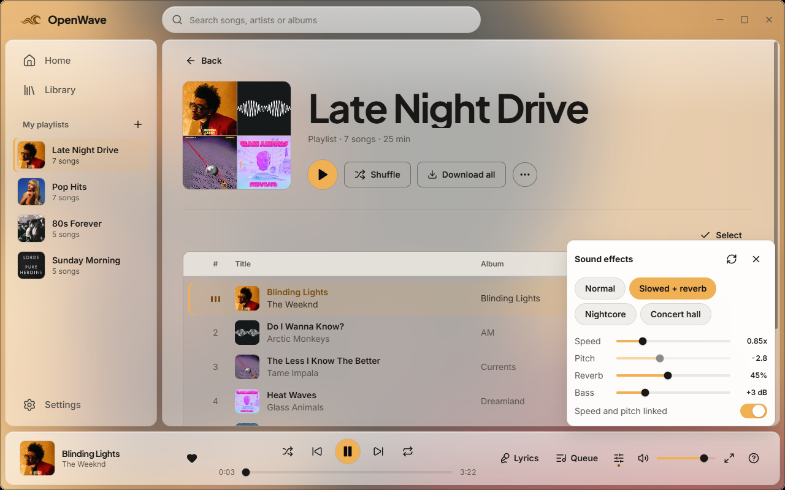
</p>

</details>

## Screenshots

### Home

<p align="center">
  <picture>
    <source media="(prefers-color-scheme: dark)" srcset="docs/media/home-dark.png">
    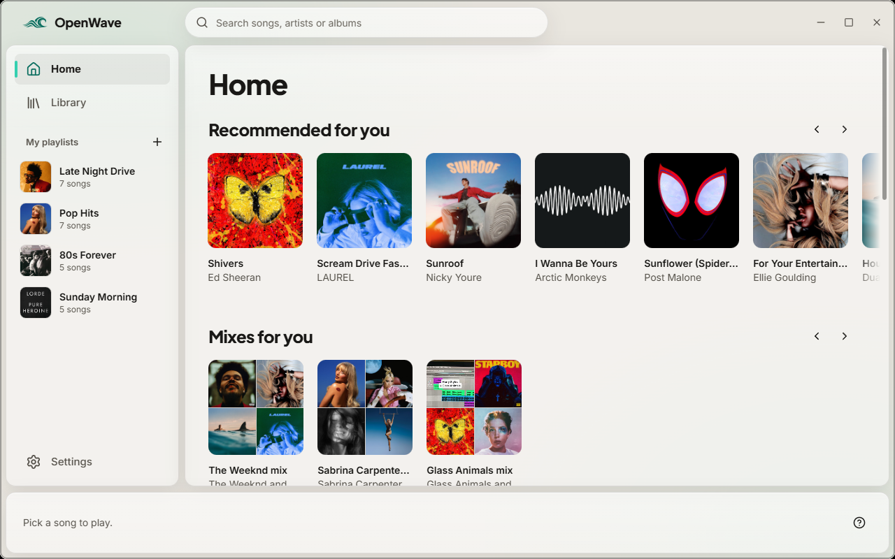
  </picture>
</p>

### Fullscreen player & synced lyrics

<p align="center">
  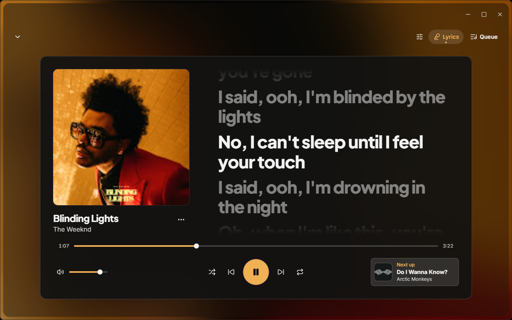
</p>

<details>
<summary>More screenshots: search, artists, playlists and settings</summary>

**Search**

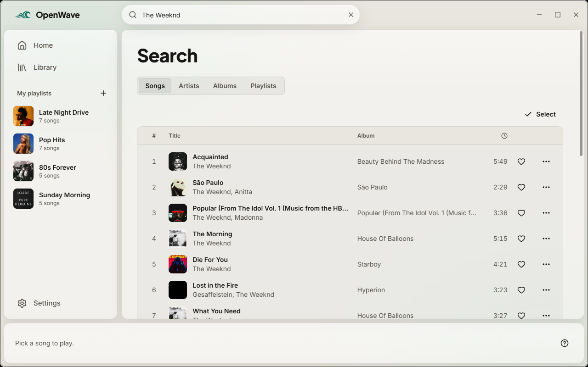

**Artist page**

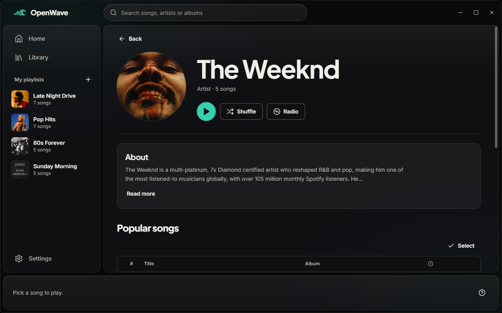

**Playlist**

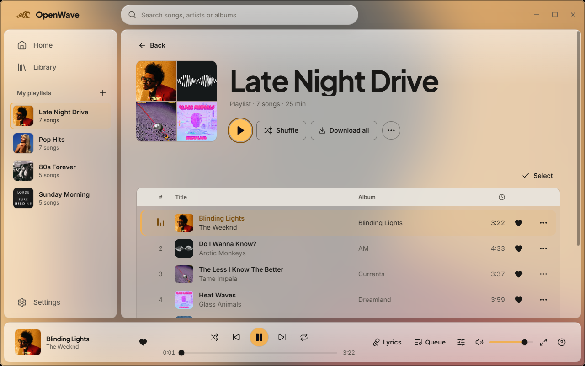

**Your library**

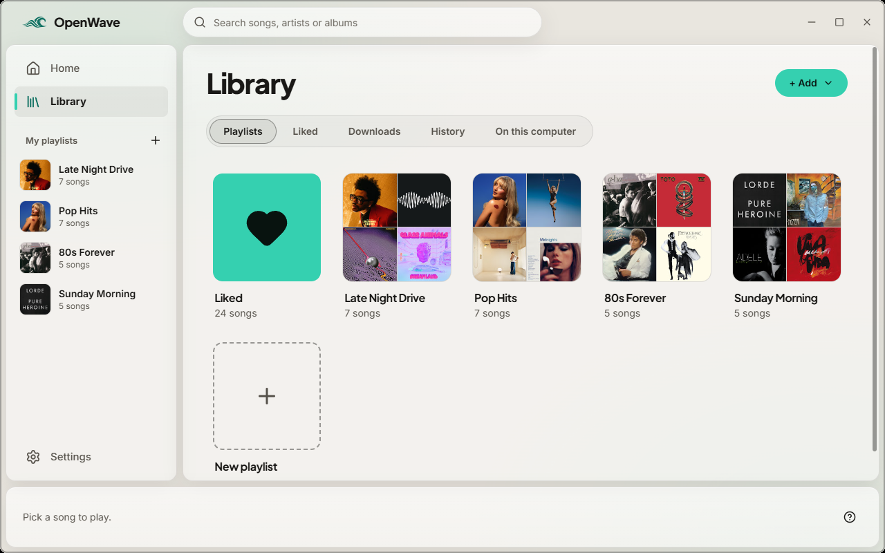

**Customization**

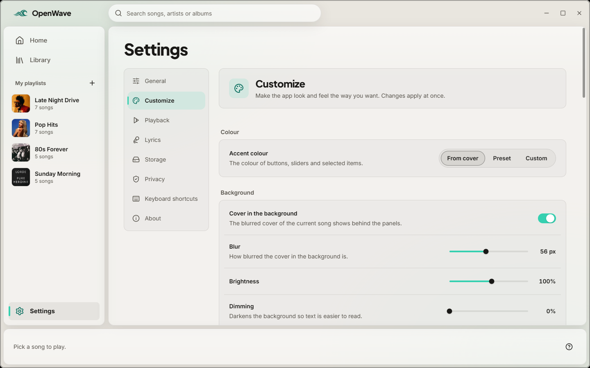

</details>

<details>
<summary>Watch demos: playback, bulk selection and themes</summary>

**Playback & fullscreen lyrics**

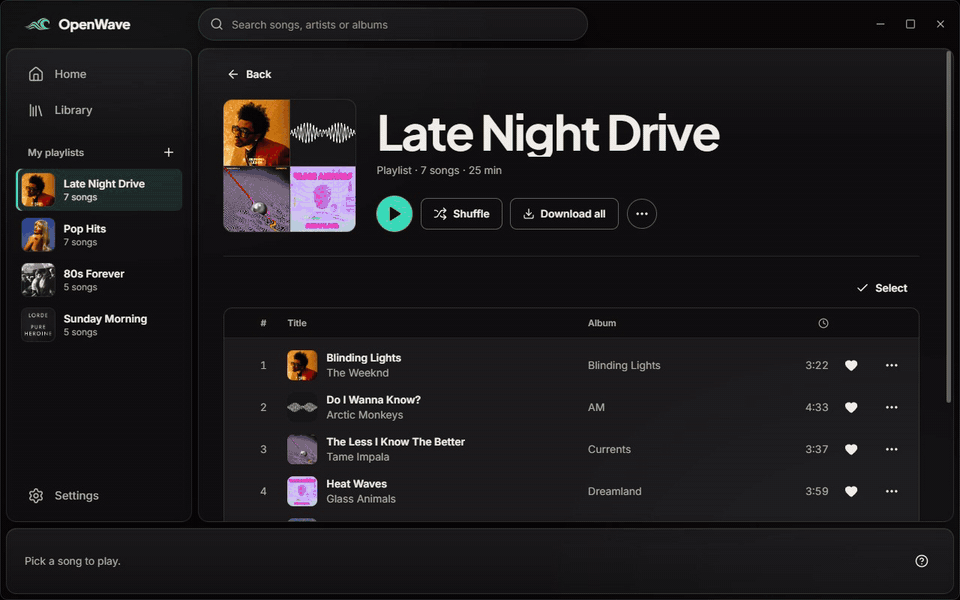

**Bulk selection**

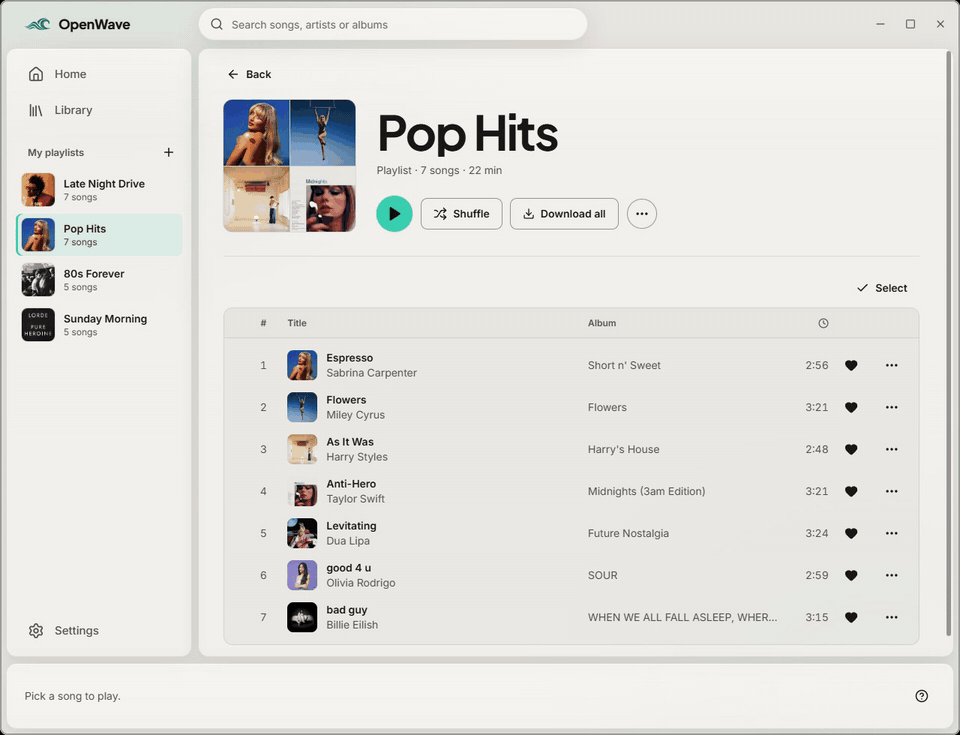

**Themes & accent colours**

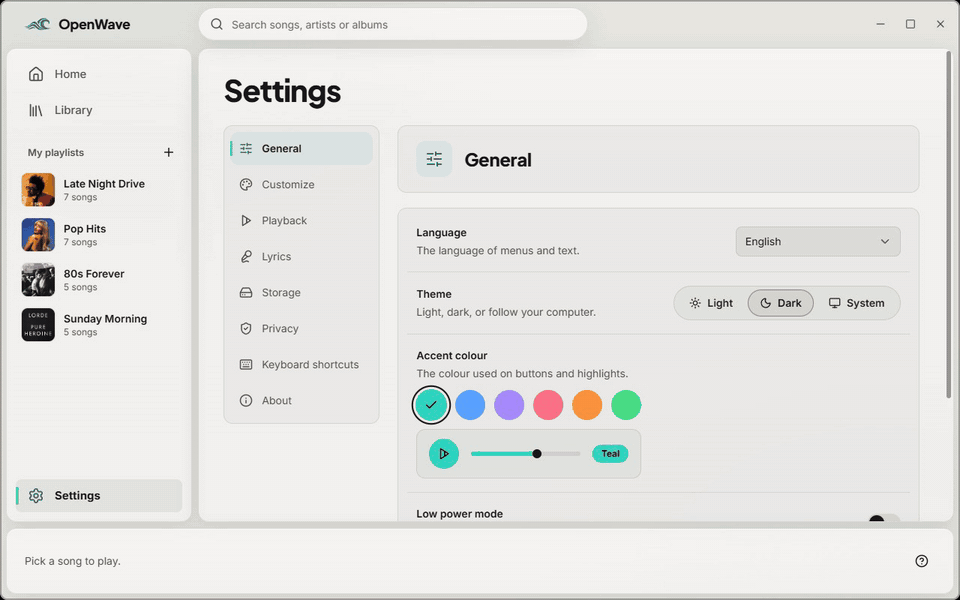

</details>

## Installation

### Windows 10 / 11

1. Download the **[installer](https://github.com/bebeyat/openwave/releases/latest/download/OpenWave-windows-x64-setup.exe)**
   and run it. It installs for your user only (no administrator prompt), adds a Start Menu shortcut and an
   uninstaller that asks whether to keep your data.
2. Prefer no installation? Download the **[portable zip](https://github.com/bebeyat/openwave/releases/latest/download/OpenWave-windows-x64-portable.zip)**,
   unzip it anywhere and run `openwave.exe`.

OpenWave uses the Microsoft Edge **WebView2 Runtime**, which is already part of Windows 10 and 11.

> [!TIP]
> Builds are not code-signed, so SmartScreen may say *"Windows protected your PC"*. If the file came from the
> official releases page and its SHA-256 matches `SHA256SUMS`, choose **More info → Run anyway**.
>
> ```powershell
> Get-FileHash .\OpenWave-windows-x64-setup.exe -Algorithm SHA256
> ```

### macOS 11+ (Apple Silicon) · experimental

1. Download **[OpenWave-macos-arm64.zip](https://github.com/bebeyat/openwave/releases/latest/download/OpenWave-macos-arm64.zip)**
   and unzip it.
2. Drag **OpenWave.app** into your **Applications** folder.
3. The app is not notarized, so the first time **right-click → Open** (or run the command below once).

```bash
xattr -dr com.apple.quarantine /Applications/OpenWave.app
```

On an Intel Mac, [build from source](#build-from-source).

### Linux (x86_64) · experimental

OpenWave needs WebKitGTK 4.1 and GTK 3 at runtime.

```bash
# Debian / Ubuntu (22.04+)
sudo apt install libwebkit2gtk-4.1-0 libgtk-3-0 libxdo3
# Fedora
sudo dnf install webkit2gtk4.1 gtk3 libxdo
# Arch
sudo pacman -S webkit2gtk-4.1 gtk3 xdotool
```

Then download and run it:

```bash
curl -LO https://github.com/bebeyat/openwave/releases/latest/download/OpenWave-linux-x86_64.tar.gz
tar -xzf OpenWave-linux-x86_64.tar.gz
./OpenWave/openwave
```

To add it to your app menu, copy `OpenWave/openwave` to `~/.local/bin/`, `openwave.png` to
`~/.local/share/icons/` and `openwave.desktop` to `~/.local/share/applications/`.

### First run

1. Start OpenWave. There is nothing to sign in to. Pick your language if the guess was wrong.
2. Search for a song, import a playlist from a link, or add a folder of music from your computer.
3. For some songs OpenWave uses the helper **[yt-dlp](https://github.com/yt-dlp/yt-dlp)** as a fallback. On
   Windows the app offers to download the official release for you (after asking). On macOS and Linux,
   install it yourself, e.g. `brew install yt-dlp` or `pipx install yt-dlp`.
4. Press <kbd>?</kbd> in the player bar to see every keyboard shortcut.

<details>
<summary><b>Keyboard shortcuts</b></summary>
<br>

| Key | Action |
|---|---|
| <kbd>Space</kbd> | Play / pause |
| <kbd>Ctrl</kbd> + <kbd>←</kbd> / <kbd>→</kbd> | Previous / next song |
| <kbd>/</kbd> or <kbd>Ctrl</kbd> + <kbd>K</kbd> | Search |
| <kbd>Q</kbd> | Queue |
| <kbd>L</kbd> | Lyrics |
| <kbd>F</kbd> | Fullscreen player |
| <kbd>M</kbd> | Mute |
| <kbd>?</kbd> | Show all shortcuts |

</details>

## Build from source

You need **Rust 1.95** (`rustup` picks the right version from `rust-toolchain.toml`) and, only if you change
styles, **Node.js 20+** for the Tailwind CSS build. `assets/main.css` is committed, so a plain
`cargo build` works without Node.

<details open>
<summary><b>Windows</b></summary>

Install the [Visual Studio Build Tools](https://visualstudio.microsoft.com/visual-cpp-build-tools/) with the
**Desktop development with C++** workload, then:

```powershell
git clone https://github.com/bebeyat/openwave
cd openwave
cargo run --release
```
</details>

<details>
<summary><b>macOS</b></summary>

```bash
xcode-select --install          # Apple command line tools
git clone https://github.com/bebeyat/openwave
cd openwave
cargo run --release
```
</details>

<details>
<summary><b>Linux</b></summary>

```bash
# Debian / Ubuntu
sudo apt install build-essential pkg-config libssl-dev \
  libwebkit2gtk-4.1-dev libgtk-3-dev libxdo-dev libayatana-appindicator3-dev librsvg2-dev
# Fedora
sudo dnf install gcc pkgconf-pkg-config openssl-devel webkit2gtk4.1-devel gtk3-devel libxdo-devel
# Arch
sudo pacman -S base-devel webkit2gtk-4.1 gtk3 xdotool

git clone https://github.com/bebeyat/openwave
cd openwave
cargo run --release
```
</details>

Changing styles? Rebuild the CSS with `cd tools && npm ci && npm run css`. Before a pull request run
`cargo fmt`, `cargo clippy --all-targets -- -D warnings` and `cargo test`. More in
[CONTRIBUTING.md](CONTRIBUTING.md) and [docs/ARCHITECTURE.md](docs/ARCHITECTURE.md).

## FAQ

<details>
<summary><b>Do I need an account?</b></summary>

No. There is no OpenWave account, and you never sign in to YouTube, Google or Spotify.
</details>

<details>
<summary><b>What leaves my computer?</b></summary>

Only what is needed for what you asked: search text and song ids sent to YouTube Music, audio requests for
the song you play, cover images, and (only if you turn them on) the song name for lyrics and your Discord
status. The full list, checked against the source code, is in [docs/PRIVACY.md](docs/PRIVACY.md).
</details>

<details>
<summary><b>Where is my data stored?</b></summary>

In your system's app-data folder, for example `%APPDATA%\OpenWave` on Windows (or the folder set in the
`OPENWAVE_DATA_DIR` environment variable). Delete it, or use the wipe option under *Settings → Privacy*, and
OpenWave forgets everything.
</details>

<details>
<summary><b>How does the Spotify import work?</b></summary>

OpenWave reads the public Spotify *embed* page of the playlist you link, takes the song names and matches
them on YouTube Music. No Spotify account or API key is used; the playlist must be public or shared by link.
Very long playlists can be cut short by Spotify's embed page, and the import dialog tells you when that happens.
</details>

<details>
<summary><b>Why didn't a song play or import?</b></summary>

Matching is by name, so a few songs may not be found, and stream access can change on YouTube's side without
notice. Please [open an issue](https://github.com/bebeyat/openwave/issues) with the song name.
</details>

## Legal notice

OpenWave is an **unofficial** client. It is not affiliated with, endorsed by or sponsored by YouTube, Google,
Spotify, Discord or LRCLIB; their names and trademarks belong to their owners. It reaches YouTube Music
through public, undocumented interfaces without logging in. That access can break at any time and may not be
permitted by those services' terms in every situation. OpenWave is meant for **personal, non-commercial use**:
offline copies are for your own listening, and the project hosts or redistributes no content.
**You are responsible for how you use it** and for following the terms of the services you connect to and
the laws where you live. yt-dlp is a separate program that is only fetched with your consent. The software
is provided as is, without warranty.

## Contributing

Bug reports, translations and pull requests are welcome. Please read [CONTRIBUTING.md](CONTRIBUTING.md) first
(including the clean-room rule: do not copy code from GPL or other apps) and the
[Code of Conduct](CODE_OF_CONDUCT.md). Found a security problem? See [SECURITY.md](SECURITY.md).

## License

Licensed under either of [Apache License 2.0](LICENSE-APACHE) or [MIT license](LICENSE-MIT) at your option
(SPDX: `MIT OR Apache-2.0`). Unless you explicitly state otherwise, any contribution intentionally submitted
for inclusion in OpenWave by you, as defined in the Apache-2.0 license, shall be dual licensed as above,
without any additional terms or conditions.

Third-party components (Rust crates, the Inter and Plus Jakarta Sans fonts, Lucide icons, Signalsmith
Stretch) are listed with their licenses in [THIRD_PARTY_NOTICES.md](THIRD_PARTY_NOTICES.md).

---

<p align="center">
  <sub>Album artwork in the screenshots belongs to the respective artists and labels and is shown only to
  illustrate the app.</sub><br>
  <sub>Made with 🦀 Rust and ♥ by the OpenWave contributors.</sub>
</p>
